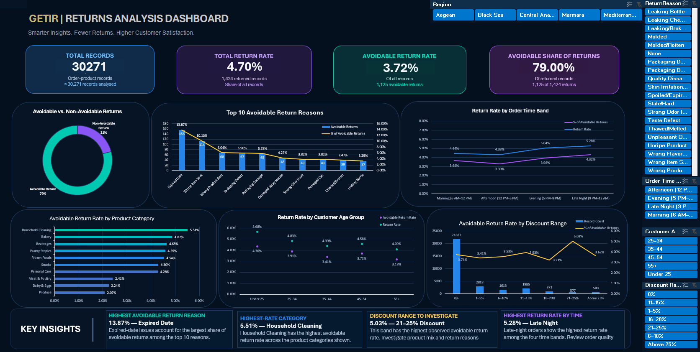
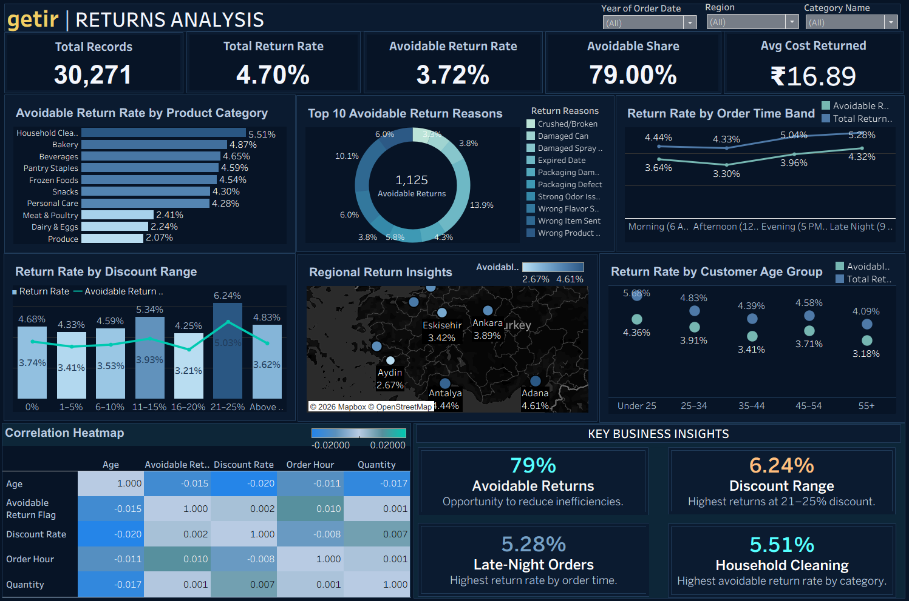

# Getir Quick Commerce Returns Analysis
**Created by:** Omkar Malgi  
**Portfolio:** Business Analyst Project  
**Connect:** [LinkedIn](https://www.linkedin.com/in/omkarmalgi/) | [GitHub](https://github.com/omkarmalgi)

A Business Analysis portfolio project exploring return patterns in quick-commerce orders using Excel, Power Query and Tableau.

The analysis examines return performance, identifies potentially avoidable returns, highlights patterns across product categories and discount ranges, and presents opportunities for operational improvement.

## Project Overview

| Detail | Description |
|---|---|
| Dataset | NextLeap-provided project dataset |
| Records analysed | 30,271 |
| Data columns | 30 |
| Reporting period | January 2021 – June 2026 |
| Tools | Excel, Power Query, PivotTables, Tableau |

## Project Objectives

- Analyse overall product return performance.
- Identify potentially avoidable returns using the project's return-reason classification.
- Understand return patterns across product categories, discounts and order times.
- Build interactive dashboards to communicate findings.
- Recommend areas for operational improvement.

## Key Findings

| Metric | Result |
|---|---:|
| Total records | 30,271 |
| Returned records | 1,424 |
| Overall return rate | 4.70% |
| Potentially avoidable returns | 1,125 |
| Avoidable share of returns | 79.00% |
| Average cost to business per returned record | ₹16.89 |

**Important:** Potentially avoidable returns are classified in this project as returned records where the return reason is not "Customer Changed Mind". This is a project-defined classification, not a verified finding of actual root cause.

## Dashboard Previews

### Excel Dashboard

### Tableau Dashboard

## Methodology

1. Combined the five supplied CSV tables using Power Query.
2. Cleaned and transformed the data for analysis.
3. Created calculated fields and performed return analysis.
4. Used PivotTables to examine key metrics and patterns.
5. Built an Excel dashboard and a Tableau dashboard.
6. Interpreted the findings and developed recommendations.

## Project Report

[View the Complete Project Report (PDF)](reports/Getir_Returns_Analysis_Report.pdf)

## Tools & Skills Demonstrated

- Microsoft Excel
- Power Query
- Data Cleaning and Transformation
- PivotTables
- Business Analysis
- KPI Analysis
- Tableau
- Data Visualization
- Insight Generation and Recommendations

## Data Disclaimer

This is an independent portfolio analysis based on project data supplied through NextLeap. It is not an analysis of Getir's internal company data, and the findings should not be interpreted as official Getir business results.
